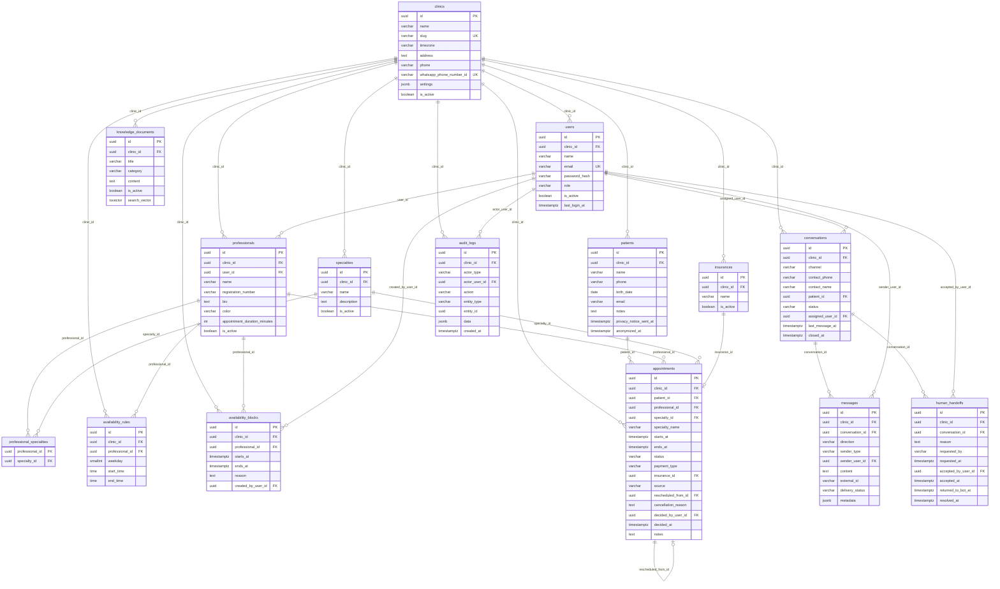

# Modelo de dados — ClinIA Backend

## Convenções globais

- Toda tabela tem `id UUID PRIMARY KEY DEFAULT gen_random_uuid()`, `created_at TIMESTAMPTZ DEFAULT now()` e `updated_at TIMESTAMPTZ DEFAULT now()`.
- Toda tabela exceto `clinics` tem `clinic_id UUID NOT NULL REFERENCES clinics(id)`.
- Datas/horas: `TIMESTAMPTZ` em UTC. Exibição calculada no fuso de `clinics.timezone`.
- Fuso padrão: `America/Sao_Paulo` (Brasília). Hardcoded no MVP; `clinics.timezone` fica na tabela para suporte futuro.
- Naming convention de constraints: `pk_<table>`, `uq_<table>_<col>`, `fk_<table>_<col>_<ref>`, `ck_<table>_<constraint>`, `ix_<col_label>`.

---

## Diagrama ER



---

## Tabelas detalhadas

### `clinics`

| Coluna | Tipo | Restrições | Descrição |
|--------|------|------------|-----------|
| `name` | VARCHAR(255) | NOT NULL | |
| `slug` | VARCHAR(100) | UNIQUE NOT NULL | Identificador URL-safe |
| `timezone` | VARCHAR(60) | NOT NULL DEFAULT `'America/Sao_Paulo'` | Fuso IANA — padrão Brasília |
| `address` | TEXT | | |
| `phone` | VARCHAR(30) | | |
| `whatsapp_phone_number_id` | VARCHAR(100) | UNIQUE | ID do número no WhatsApp Business API |
| `settings` | JSONB | NOT NULL DEFAULT `'{}'` | Ver abaixo |
| `is_active` | BOOLEAN | NOT NULL DEFAULT TRUE | |

**`settings` JSONB** (defaults e significados):
```json
{
  "min_booking_notice_hours": 2,
  "min_cancel_notice_hours": 24,
  "booking_window_days": 30,
  "privacy_notice_text": null,
  "handoff_message_text": null
}
```

---

### `users`
`clinic_id` é NULL apenas para `superadmin`.

| Coluna | Tipo | Restrições |
|--------|------|------------|
| `clinic_id` | UUID | FK → clinics, nullable |
| `name` | VARCHAR(255) | NOT NULL |
| `email` | VARCHAR(255) | UNIQUE NOT NULL |
| `password_hash` | VARCHAR(255) | nullable |
| `role` | VARCHAR(30) | NOT NULL — valores: `superadmin`, `admin`, `attendant`, `professional` |
| `is_active` | BOOLEAN | NOT NULL DEFAULT TRUE |
| `last_login_at` | TIMESTAMPTZ | nullable |

---

### `specialties`

| Coluna | Tipo | Restrições |
|--------|------|------------|
| `name` | VARCHAR(100) | NOT NULL |
| `description` | TEXT | nullable |
| `is_active` | BOOLEAN | NOT NULL DEFAULT TRUE |

Constraint: `UNIQUE (clinic_id, name)`.

---

### `professionals`

| Coluna | Tipo | Restrições | Descrição |
|--------|------|------------|-----------|
| `user_id` | UUID | FK → users, UNIQUE, nullable | Vincula a uma conta de acesso |
| `name` | VARCHAR(255) | NOT NULL | |
| `registration_number` | VARCHAR(50) | nullable | CRM, CRN etc. |
| `bio` | TEXT | nullable | |
| `color` | VARCHAR(7) | NOT NULL DEFAULT `'#397e67'` | Cor hex para exibição na agenda |
| `appointment_duration_minutes` | INT | NOT NULL DEFAULT 30 | |
| `is_active` | BOOLEAN | NOT NULL DEFAULT TRUE | |

---

### `professional_specialties`

| Coluna | Tipo |
|--------|------|
| `professional_id` | UUID FK → professionals |
| `specialty_id` | UUID FK → specialties |

PK composta: `(professional_id, specialty_id)`.

---

### `insurances`
Convênios aceitos pela clínica.

| Coluna | Tipo | Restrições |
|--------|------|------------|
| `name` | VARCHAR(100) | NOT NULL |
| `is_active` | BOOLEAN | NOT NULL DEFAULT TRUE |

Constraint: `UNIQUE (clinic_id, name)`.

---

### `availability_rules`
Horários semanais recorrentes.

| Coluna | Tipo | Restrições | Descrição |
|--------|------|------------|-----------|
| `professional_id` | UUID | FK → professionals NOT NULL | |
| `weekday` | SMALLINT | NOT NULL — `0=segunda, 1=terça … 6=domingo` | Convenção do CRM |
| `start_time` | TIME | NOT NULL | |
| `end_time` | TIME | NOT NULL CHECK `end_time > start_time` | |

Sem `is_active` — regras são apagadas de verdade (DELETE com auditoria).

Sem sobreposição no mesmo `(professional_id, weekday)` — constraint de exclusão com `btree_gist`.

---

### `availability_blocks`
Bloqueios pontuais.

| Coluna | Tipo | Restrições | Descrição |
|--------|------|------------|-----------|
| `professional_id` | UUID | FK → professionals, nullable | NULL = bloqueia toda a clínica |
| `starts_at` | TIMESTAMPTZ | NOT NULL | |
| `ends_at` | TIMESTAMPTZ | NOT NULL CHECK `ends_at > starts_at` | |
| `reason` | TEXT | nullable | |
| `created_by_user_id` | UUID | FK → users | |

---

### `patients`

| Coluna | Tipo | Restrições | Descrição |
|--------|------|------------|-----------|
| `name` | VARCHAR(255) | NOT NULL | |
| `phone` | VARCHAR(30) | NOT NULL | Formato E.164 |
| `birth_date` | DATE | nullable | |
| `email` | VARCHAR(255) | nullable | |
| `notes` | TEXT | nullable | Observações administrativas (sem dados de saúde) |
| `privacy_notice_sent_at` | TIMESTAMPTZ | nullable | |
| `anonymized_at` | TIMESTAMPTZ | nullable | Após anonimização LGPD |

Constraint: `UNIQUE (clinic_id, phone)`.

---

### `appointments`

| Coluna | Tipo | Restrições | Descrição |
|--------|------|------------|-----------|
| `patient_id` | UUID | FK → patients NOT NULL | |
| `professional_id` | UUID | FK → professionals NOT NULL | |
| `specialty_id` | UUID | FK → specialties NOT NULL | |
| `specialty_name` | VARCHAR(100) | NOT NULL | Desnormalizado para listagens |
| `starts_at` | TIMESTAMPTZ | NOT NULL | |
| `ends_at` | TIMESTAMPTZ | NOT NULL | |
| `status` | VARCHAR(20) | NOT NULL — `pending, confirmed, rejected, cancelled, completed, no_show` | |
| `payment_type` | VARCHAR(20) | NOT NULL — `insurance, private` | |
| `insurance_id` | UUID | FK → insurances, nullable | Obrigatório se `payment_type = insurance` |
| `source` | VARCHAR(20) | NOT NULL — `agent, dashboard` | |
| `rescheduled_from_id` | UUID | FK → appointments, nullable | |
| `cancellation_reason` | TEXT | nullable | |
| `decided_by_user_id` | UUID | FK → users, nullable | |
| `decided_at` | TIMESTAMPTZ | nullable | |
| `notes` | TEXT | nullable | Anotações administrativas pós-consulta |

**Constraint de não-sobreposição** (GiST/btree_gist): o mesmo `professional_id` não pode ter dois agendamentos com `status IN ('pending','confirmed')` com intervalos `[starts_at, ends_at)` sobrepostos.

**Transições de status permitidas:**
```
pending   → confirmed | rejected | cancelled
confirmed → cancelled | completed | no_show
```

**Remarcação:** cria novo `pending` com `rescheduled_from_id` → antigo. Se novo vai a `confirmed`, antigo vai a `cancelled`. Se novo vai a `rejected`, antigo permanece.

---

### `conversations`

| Coluna | Tipo | Restrições | Descrição |
|--------|------|------------|-----------|
| `channel` | VARCHAR(20) | NOT NULL — `simulator, whatsapp` | |
| `contact_phone` | VARCHAR(30) | NOT NULL | |
| `contact_name` | VARCHAR(255) | nullable | |
| `patient_id` | UUID | FK → patients, nullable | Vinculado após identificação |
| `status` | VARCHAR(20) | NOT NULL — `bot, waiting_human, human, closed` | |
| `assigned_user_id` | UUID | FK → users, nullable | |
| `last_message_at` | TIMESTAMPTZ | nullable | |
| `closed_at` | TIMESTAMPTZ | nullable | |

Partial unique index: `UNIQUE (clinic_id, channel, contact_phone) WHERE status != 'closed'`.

**Transições:**
```
bot → waiting_human → human → bot
qualquer → closed
```

---

### `messages`

| Coluna | Tipo | Restrições |
|--------|------|------------|
| `conversation_id` | UUID | FK → conversations NOT NULL |
| `direction` | VARCHAR(10) | NOT NULL — `inbound, outbound` |
| `sender_type` | VARCHAR(20) | NOT NULL — `patient, agent, attendant, system` |
| `sender_user_id` | UUID | FK → users, nullable |
| `content` | TEXT | NOT NULL |
| `external_id` | VARCHAR(255) | nullable |
| `delivery_status` | VARCHAR(20) | NOT NULL DEFAULT `'pending'` — `pending, sent, delivered, read, failed` |
| `metadata` | JSONB | NOT NULL DEFAULT `'{}'` |

Partial unique index: `UNIQUE (clinic_id, external_id) WHERE external_id IS NOT NULL`.

---

### `human_handoffs`

| Coluna | Tipo | Restrições |
|--------|------|------------|
| `conversation_id` | UUID | FK → conversations NOT NULL |
| `reason` | TEXT | nullable |
| `requested_by` | VARCHAR(20) | NOT NULL — `agent, patient, attendant, system` |
| `requested_at` | TIMESTAMPTZ | NOT NULL |
| `accepted_by_user_id` | UUID | FK → users, nullable |
| `accepted_at` | TIMESTAMPTZ | nullable |
| `returned_to_bot_at` | TIMESTAMPTZ | nullable |
| `resolved_at` | TIMESTAMPTZ | nullable |

---

### `knowledge_documents`

| Coluna | Tipo | Restrições |
|--------|------|------------|
| `title` | VARCHAR(255) | NOT NULL |
| `category` | VARCHAR(50) | NOT NULL — `faq, policy, preparation, pricing, general` |
| `content` | TEXT | NOT NULL |
| `is_active` | BOOLEAN | NOT NULL DEFAULT TRUE |
| `search_vector` | TSVECTOR | gerado via trigger; configuração `pt_unaccent` (`websearch_to_tsquery`, `ts_rank`), máx 3 resultados |

---

### `audit_logs`
Imutável — sem `updated_at`.

| Coluna | Tipo | Restrições |
|--------|------|------------|
| `actor_type` | VARCHAR(20) | NOT NULL — `user, agent, system` |
| `actor_user_id` | UUID | FK → users, nullable |
| `action` | VARCHAR(100) | NOT NULL (ex.: `appointment.confirmed`) |
| `entity_type` | VARCHAR(50) | NOT NULL |
| `entity_id` | UUID | NOT NULL |
| `data` | JSONB | NOT NULL DEFAULT `'{}'` |

> Nunca conter dados de saúde, senha ou token.

---

## Ajustes vindos do CRM

### Incorporados ao modelo acima

| Campo | Tabela | Origem | Justificativa |
|-------|--------|--------|---------------|
| `color VARCHAR(7)` | `professionals` | `src/lib/types.ts` → `Professional.color` | Agenda exibe cada profissional com cor hex |
| `notes TEXT` | `patients` | `src/lib/types.ts` → `Patient.notes` | Painel de conversa e detalhe do paciente exibem observações |
| `specialty_name VARCHAR(100)` | `appointments` | `src/lib/types.ts` → `Appointment.specialty` (string) | CRM exibe nome sem FK; desnormalizar evita JOIN e preserva histórico |
| `weekday 0=segunda` | `availability_rules` | `src/lib/demo-data.ts` → `hours([1,2,3,4,5], …)` | Convenção do CRM: 0=seg, 1=ter, …, 6=dom (≠ JS onde 0=dom) |

### Campos do CRM sem correspondência no modelo (dúvidas em aberto)

Ver seção seguinte.

---

## Decisões arquiteturais

Todas as decisões abaixo foram tomadas antes da Fase 2 (models + migrations).

### Fuso horário (D1)
`America/Sao_Paulo` (Brasília) hardcoded no MVP. A coluna `clinics.timezone` existe para suporte futuro.

### Soft-delete — padrão `is_active` (D2)

**Tabelas com `is_active BOOLEAN NOT NULL DEFAULT true`:** `clinics`, `users`, `specialties`, `professionals`, `insurances`, `knowledge_documents`.
- `DELETE` nessas rotas só desativa (`is_active = false`). Quem desativou e quando fica em `audit_logs`.
- Listagens retornam só ativos por padrão; `?includeInactive=true` serve para telas administrativas.
- As ferramentas do agente e `/slots` enxergam só ativos.
- Consultas de histórico (`appointments`, `conversations`) mostram o registro mesmo que relacionado a um inativo.

**Nomes únicos + reativação:** índices únicos continuam normais (ex.: `UNIQUE (clinic_id, name)`). Criar um nome que já existe inativo retorna `409 CONFLICT` com `existingId` nos detalhes do erro.

**Tabelas sem `is_active`:**
- `availability_blocks` e `availability_rules` — apagadas de verdade (DELETE com auditoria).
- `appointments` e `conversations` — usam `status` como ciclo de vida.
- `patients` — sem `is_active` e sem `deleted_at`; remoção é anonimização LGPD via `anonymized_at`.
- `messages`, `human_handoffs`, `audit_logs` — nunca apagadas.

### Profissionais e usuários (D3)
Entidades separadas com vínculo opcional 1:1: `professionals.user_id FK(users) UNIQUE NULL`.
- Profissional sem login é o caso normal; agenda gerida por admin/atendentes.
- Usuário com `role = professional` DEVE estar vinculado a um profissional da mesma clínica.
- **Desativar profissional desativa o usuário vinculado.** O contrário não vale.

### Duração de consulta (D4)
Por profissional: `professionals.appointment_duration_minutes INT NOT NULL DEFAULT 30` (10–240 min).
Mudar a duração afeta só slots futuros; agendamentos existentes mantêm `ends_at` gravado.

### Remarcações (D5)
Nada some; sem tabela de histórico separada.
- `POST /appointments/{id}/reschedule` cria novo `pending` com `rescheduled_from_id` apontando para o original.
- O original continua valendo até a decisão da clínica. Ao confirmar o novo → original vai a `cancelled` (razão: "remarcado"). Ao rejeitar o novo → original permanece.
- Só uma remarcação pendente por agendamento; segunda tentativa retorna `409 RESCHEDULE_ALREADY_PENDING`.
- Na resposta da API, o agendamento inclui `rescheduledFrom` (objeto: `startsAt`, `endsAt`, `professionalName`) e `rescheduledToId`.
- Tela "Início": `GET /appointments?status=pending&reschedule=true` + campo `pendingReschedules` em `GET /dashboard/summary`.

### Base de conhecimento (D6)
Busca full-text do PostgreSQL — sem embeddings no MVP.
- Configuração `pt_unaccent`, `websearch_to_tsquery`, `ts_rank`; ferramenta `search_knowledge` devolve até 3 trechos.
- Dados estruturados (endereço, horário, convênios) vêm de ferramentas dedicadas (`get_clinic_info`, `check_insurance`).
- Busca semântica com pgvector fica como trabalho futuro; a interface da ferramenta não mudará.

### Limites do WhatsApp (D7)
Limites são da Meta — não implementamos limitador de envio no MVP.
- Cada clínica tem `clinics.whatsapp_phone_number_id`. No MVP todas compartilham o mesmo token/portfolio Meta.
- Tratar erros da Meta: `130429` (vazão excedida) → até 3 retries com backoff; depois `delivery_status = failed` + log + evento para o CRM.

### Auditoria (D8)
Ações registradas sempre com `actor_type` (`user`, `agent` ou `system`):

| Categoria | Ações |
|-----------|-------|
| Acesso | login OK, login falho (sem senha em `data`) |
| Administração | alterar clínica/settings; criar/editar/desativar usuários, especialidades, profissionais, convênios, documentos; alterar regras de agenda; criar/remover bloqueios |
| Agendamentos | criar, confirmar, rejeitar, cancelar, remarcar, concluir, falta (inclusive pelo agente) |
| Conversas | handoff solicitado, assumir, devolver à IA, encerrar |
| LGPD | criar/editar paciente, exportar dados, anonimizar |

Fora da auditoria: mensagens (ficam em `messages`), leituras/listagens (exceto exportação), ferramentas do agente.

`data` guarda somente campos alterados (antes + depois). **Nunca** conter senha, token, conteúdo de mensagem ou dado de saúde.

### Simulador (D9)
Usa número fictício em E.164 — nunca o telefone real de alguém.
- Gera número fictício por sessão; reaproveita até `POST /simulator/{slug}/reset`.
- Usuário pode escolher o telefone de um paciente do seed para simular paciente já cadastrado.
- Conversas do simulador ficam com `channel = simulator` (não se misturam com WhatsApp).
- `SIMULATOR_ENABLED = true` apenas em desenvolvimento, demo ou clínica de demonstração.

---

## Questões ainda em aberto (CRM → backend)

> Decisões necessárias para o CRM antes de consumir esses endpoints.

**CQ1 — `appointment.date` / `appointment.start` vs `startsAt`**
O CRM usa `date: "YYYY-MM-DD"` + `start: "HH:MM"`. A API retorna `startsAt` ISO 8601 UTC. O CRM precisa ser atualizado para consumir `startsAt`/`endsAt`/`durationMinutes` ou a API deve retornar campos calculados `date` e `startTime` adicionalmente?

**CQ2 — `patient.insurance` como string vs `insuranceId`**
O CRM usa `insurance: string` (nome). No modelo, convênio está só no agendamento (sem `insurance_id` em `patients`). O CRM deve passar a usar `insuranceId` ao criar/editar paciente, ou o backend aceita `insuranceName` e resolve internamente?

**CQ3 — `professional.availability` embutida vs segunda chamada**
O CRM exibe `availability: WeekSlot[]` dentro do profissional. `GET /professionals/{id}` deve incluir `availabilityRules` embutido ou o CRM faz `GET /professionals/{id}/availability-rules` separadamente?

**CQ4 — `appointment.notes` como array vs texto único**
O CRM tem `appointment.notes: ConsultationNote[]` (array com histórico). O modelo tem `appointments.notes TEXT` (uma nota). Simplificar para nota única editável, ou criar tabela `appointment_notes`?

**CQ5 — `conversation.reason` como campo direto vs JOIN**
O CRM usa `conversation.reason?: string`. O modelo tem `human_handoffs.reason`. O `GET /conversations` retorna `handoffReason` via JOIN ao handoff mais recente, ou duplica o campo em `conversations`?
