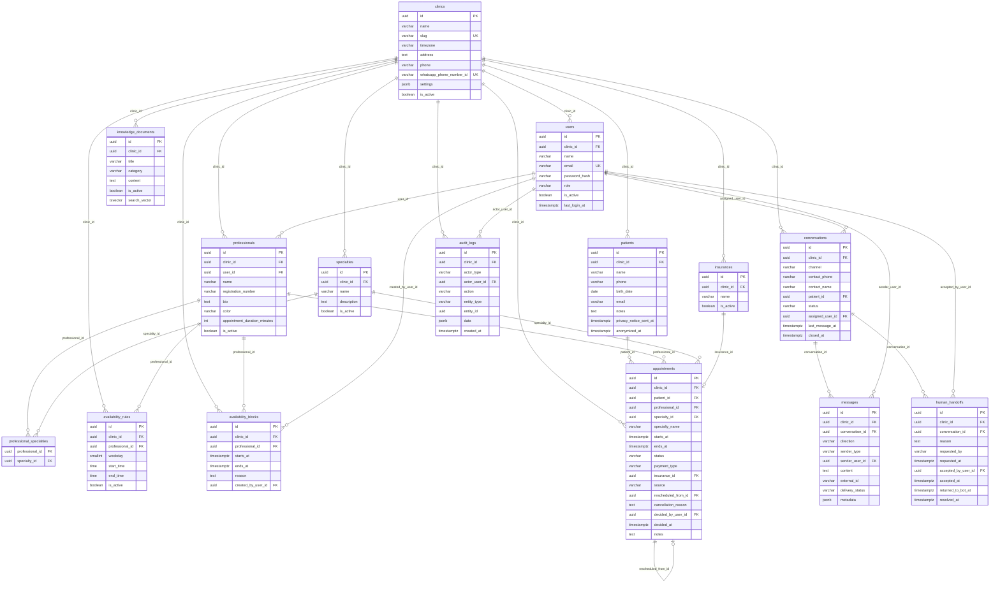

# Modelo de dados — ClinIA Backend

## Convenções globais

- Toda tabela tem `id UUID PRIMARY KEY DEFAULT gen_random_uuid()`, `created_at TIMESTAMPTZ DEFAULT now()` e `updated_at TIMESTAMPTZ DEFAULT now()`.
- Toda tabela exceto `clinics` tem `clinic_id UUID NOT NULL REFERENCES clinics(id)`.
- Datas/horas: `TIMESTAMPTZ` em UTC. Exibição calculada no fuso de `clinics.timezone`.
- Naming convention de constraints: `pk_<table>`, `uq_<table>_<col>`, `fk_<table>_<col>_<ref>`, `ck_<table>_<constraint>`, `ix_<col_label>`.

---

## Diagrama ER



---

## Tabelas detalhadas

### `clinics`

| Coluna | Tipo | Restrições | Descrição |
|--------|------|------------|-----------|
| `name` | VARCHAR(255) | NOT NULL | |
| `slug` | VARCHAR(100) | UNIQUE NOT NULL | Identificador URL-safe |
| `timezone` | VARCHAR(60) | NOT NULL DEFAULT `'America/Fortaleza'` | Fuso IANA |
| `address` | TEXT | | |
| `phone` | VARCHAR(30) | | |
| `whatsapp_phone_number_id` | VARCHAR(100) | UNIQUE | ID do número no WhatsApp Business API |
| `settings` | JSONB | NOT NULL DEFAULT `'{}'` | Ver abaixo |
| `is_active` | BOOLEAN | NOT NULL DEFAULT TRUE | |

**`settings` JSONB** (defaults e significados):
```json
{
  "min_booking_notice_hours": 2,
  "min_cancel_notice_hours": 24,
  "booking_window_days": 30,
  "privacy_notice_text": null,
  "handoff_message_text": null
}
```

---

### `users`
`clinic_id` é NULL apenas para `superadmin`.

| Coluna | Tipo | Restrições |
|--------|------|------------|
| `clinic_id` | UUID | FK → clinics, nullable |
| `name` | VARCHAR(255) | NOT NULL |
| `email` | VARCHAR(255) | UNIQUE NOT NULL |
| `password_hash` | VARCHAR(255) | nullable |
| `role` | VARCHAR(30) | NOT NULL — valores: `superadmin`, `admin`, `attendant`, `professional` |
| `is_active` | BOOLEAN | NOT NULL DEFAULT TRUE |
| `last_login_at` | TIMESTAMPTZ | nullable |

---

### `specialties`

| Coluna | Tipo | Restrições |
|--------|------|------------|
| `name` | VARCHAR(100) | NOT NULL |
| `description` | TEXT | nullable |
| `is_active` | BOOLEAN | NOT NULL DEFAULT TRUE |

Constraint: `UNIQUE (clinic_id, name)`.

---

### `professionals`

| Coluna | Tipo | Restrições | Descrição |
|--------|------|------------|-----------|
| `user_id` | UUID | FK → users, UNIQUE, nullable | Vincula a uma conta de acesso |
| `name` | VARCHAR(255) | NOT NULL | |
| `registration_number` | VARCHAR(50) | nullable | CRM, CRN etc. |
| `bio` | TEXT | nullable | |
| `color` | VARCHAR(7) | NOT NULL DEFAULT `'#397e67'` | Cor hex para exibição na agenda |
| `appointment_duration_minutes` | INT | NOT NULL DEFAULT 30 | |
| `is_active` | BOOLEAN | NOT NULL DEFAULT TRUE | |

---

### `professional_specialties`

| Coluna | Tipo |
|--------|------|
| `professional_id` | UUID FK → professionals |
| `specialty_id` | UUID FK → specialties |

PK composta: `(professional_id, specialty_id)`.

---

### `insurances`
Convênios aceitos pela clínica.

| Coluna | Tipo | Restrições |
|--------|------|------------|
| `name` | VARCHAR(100) | NOT NULL |
| `is_active` | BOOLEAN | NOT NULL DEFAULT TRUE |

Constraint: `UNIQUE (clinic_id, name)`.

---

### `availability_rules`
Horários semanais recorrentes.

| Coluna | Tipo | Restrições | Descrição |
|--------|------|------------|-----------|
| `professional_id` | UUID | FK → professionals NOT NULL | |
| `weekday` | SMALLINT | NOT NULL — `0=segunda, 1=terça … 6=domingo` | Convenção do CRM |
| `start_time` | TIME | NOT NULL | |
| `end_time` | TIME | NOT NULL CHECK `end_time > start_time` | |
| `is_active` | BOOLEAN | NOT NULL DEFAULT TRUE | |

Sem sobreposição no mesmo `(professional_id, weekday)` — constraint de exclusão com `btree_gist`.

---

### `availability_blocks`
Bloqueios pontuais.

| Coluna | Tipo | Restrições | Descrição |
|--------|------|------------|-----------|
| `professional_id` | UUID | FK → professionals, nullable | NULL = bloqueia toda a clínica |
| `starts_at` | TIMESTAMPTZ | NOT NULL | |
| `ends_at` | TIMESTAMPTZ | NOT NULL CHECK `ends_at > starts_at` | |
| `reason` | TEXT | nullable | |
| `created_by_user_id` | UUID | FK → users | |

---

### `patients`

| Coluna | Tipo | Restrições | Descrição |
|--------|------|------------|-----------|
| `name` | VARCHAR(255) | NOT NULL | |
| `phone` | VARCHAR(30) | NOT NULL | Formato E.164 |
| `birth_date` | DATE | nullable | |
| `email` | VARCHAR(255) | nullable | |
| `notes` | TEXT | nullable | Observações administrativas (sem dados de saúde) |
| `privacy_notice_sent_at` | TIMESTAMPTZ | nullable | |
| `anonymized_at` | TIMESTAMPTZ | nullable | Após anonimização LGPD |

Constraint: `UNIQUE (clinic_id, phone)`.

---

### `appointments`

| Coluna | Tipo | Restrições | Descrição |
|--------|------|------------|-----------|
| `patient_id` | UUID | FK → patients NOT NULL | |
| `professional_id` | UUID | FK → professionals NOT NULL | |
| `specialty_id` | UUID | FK → specialties NOT NULL | |
| `specialty_name` | VARCHAR(100) | NOT NULL | Desnormalizado para listagens |
| `starts_at` | TIMESTAMPTZ | NOT NULL | |
| `ends_at` | TIMESTAMPTZ | NOT NULL | |
| `status` | VARCHAR(20) | NOT NULL — `pending, confirmed, rejected, cancelled, completed, no_show` | |
| `payment_type` | VARCHAR(20) | NOT NULL — `insurance, private` | |
| `insurance_id` | UUID | FK → insurances, nullable | Obrigatório se `payment_type = insurance` |
| `source` | VARCHAR(20) | NOT NULL — `agent, dashboard` | |
| `rescheduled_from_id` | UUID | FK → appointments, nullable | |
| `cancellation_reason` | TEXT | nullable | |
| `decided_by_user_id` | UUID | FK → users, nullable | |
| `decided_at` | TIMESTAMPTZ | nullable | |
| `notes` | TEXT | nullable | Anotações administrativas pós-consulta |

**Constraint de não-sobreposição** (GiST/btree_gist): o mesmo `professional_id` não pode ter dois agendamentos com `status IN ('pending','confirmed')` com intervalos `[starts_at, ends_at)` sobrepostos.

**Transições de status permitidas:**
```
pending   → confirmed | rejected | cancelled
confirmed → cancelled | completed | no_show
```

**Remarcação:** cria novo `pending` com `rescheduled_from_id` → antigo. Se novo vai a `confirmed`, antigo vai a `cancelled`. Se novo vai a `rejected`, antigo permanece.

---

### `conversations`

| Coluna | Tipo | Restrições | Descrição |
|--------|------|------------|-----------|
| `channel` | VARCHAR(20) | NOT NULL — `simulator, whatsapp` | |
| `contact_phone` | VARCHAR(30) | NOT NULL | |
| `contact_name` | VARCHAR(255) | nullable | |
| `patient_id` | UUID | FK → patients, nullable | Vinculado após identificação |
| `status` | VARCHAR(20) | NOT NULL — `bot, waiting_human, human, closed` | |
| `assigned_user_id` | UUID | FK → users, nullable | |
| `last_message_at` | TIMESTAMPTZ | nullable | |
| `closed_at` | TIMESTAMPTZ | nullable | |

Partial unique index: `UNIQUE (clinic_id, channel, contact_phone) WHERE status != 'closed'`.

**Transições:**
```
bot → waiting_human → human → bot
qualquer → closed
```

---

### `messages`

| Coluna | Tipo | Restrições |
|--------|------|------------|
| `conversation_id` | UUID | FK → conversations NOT NULL |
| `direction` | VARCHAR(10) | NOT NULL — `inbound, outbound` |
| `sender_type` | VARCHAR(20) | NOT NULL — `patient, agent, attendant, system` |
| `sender_user_id` | UUID | FK → users, nullable |
| `content` | TEXT | NOT NULL |
| `external_id` | VARCHAR(255) | nullable |
| `delivery_status` | VARCHAR(20) | NOT NULL DEFAULT `'pending'` — `pending, sent, delivered, read, failed` |
| `metadata` | JSONB | NOT NULL DEFAULT `'{}'` |

Partial unique index: `UNIQUE (clinic_id, external_id) WHERE external_id IS NOT NULL`.

---

### `human_handoffs`

| Coluna | Tipo | Restrições |
|--------|------|------------|
| `conversation_id` | UUID | FK → conversations NOT NULL |
| `reason` | TEXT | nullable |
| `requested_by` | VARCHAR(20) | NOT NULL — `agent, patient, attendant, system` |
| `requested_at` | TIMESTAMPTZ | NOT NULL |
| `accepted_by_user_id` | UUID | FK → users, nullable |
| `accepted_at` | TIMESTAMPTZ | nullable |
| `returned_to_bot_at` | TIMESTAMPTZ | nullable |
| `resolved_at` | TIMESTAMPTZ | nullable |

---

### `knowledge_documents`

| Coluna | Tipo | Restrições |
|--------|------|------------|
| `title` | VARCHAR(255) | NOT NULL |
| `category` | VARCHAR(50) | NOT NULL — `faq, policy, preparation, pricing, general` |
| `content` | TEXT | NOT NULL |
| `is_active` | BOOLEAN | NOT NULL DEFAULT TRUE |
| `search_vector` | TSVECTOR | gerado via trigger em `title || content` |

---

### `audit_logs`
Imutável — sem `updated_at`.

| Coluna | Tipo | Restrições |
|--------|------|------------|
| `actor_type` | VARCHAR(20) | NOT NULL — `user, agent, system` |
| `actor_user_id` | UUID | FK → users, nullable |
| `action` | VARCHAR(100) | NOT NULL (ex.: `appointment.confirmed`) |
| `entity_type` | VARCHAR(50) | NOT NULL |
| `entity_id` | UUID | NOT NULL |
| `data` | JSONB | NOT NULL DEFAULT `'{}'` |

> Nunca conter dados de saúde, senha ou token.

---

## Ajustes vindos do CRM

### Incorporados ao modelo acima

| Campo | Tabela | Origem | Justificativa |
|-------|--------|--------|---------------|
| `color VARCHAR(7)` | `professionals` | `src/lib/types.ts` → `Professional.color` | Agenda exibe cada profissional com cor hex |
| `notes TEXT` | `patients` | `src/lib/types.ts` → `Patient.notes` | Painel de conversa e detalhe do paciente exibem observações |
| `specialty_name VARCHAR(100)` | `appointments` | `src/lib/types.ts` → `Appointment.specialty` (string) | CRM exibe nome sem FK; desnormalizar evita JOIN e preserva histórico |
| `weekday 0=segunda` | `availability_rules` | `src/lib/demo-data.ts` → `hours([1,2,3,4,5], …)` | Convenção do CRM: 0=seg, 1=ter, …, 6=dom (≠ JS onde 0=dom) |

### Campos do CRM sem correspondência no modelo (dúvidas em aberto)

Ver seção seguinte.

---

## Dúvidas em aberto

> Estas questões precisam de resposta antes de começar a Fase 2 (models + migrations).

**D1 — `appointment.date` / `appointment.start` vs `starts_at`**
O CRM usa dois campos separados: `date: "YYYY-MM-DD"` e `start: "HH:MM"`. O modelo proposto usa `starts_at TIMESTAMPTZ`. A API deve retornar `date` e `startTime` como campos calculados em camelCase? Ou o CRM será atualizado para trabalhar com `startsAt` ISO 8601?

**D2 — `appointment.duration`**
O CRM tem `duration: number` (minutos). No modelo, a duração é derivada de `ends_at - starts_at`. A API deve retornar `durationMinutes` calculado?

**D3 — `patient.insurance` como string vs FK**
O CRM associa o paciente a um convênio por **nome** (`insurance: string`). O modelo proposto **não** tem `insurance_id` em `patients` — o convênio está só no agendamento. O CRM deve passar a usar `insuranceId` ao criar/editar paciente, ou o backend deve aceitar um campo `insuranceName` e resolver o ID internamente?

**D4 — `knowledge.archived` vs `is_active`**
O CRM usa `archived: boolean` (verdadeiro = arquivado). O modelo usa `is_active: boolean` (verdadeiro = ativo). São inversos. O CRM deve ser atualizado para usar `isActive`, ou a API expõe os dois?

**D5 — Status em inglês vs português**
O CRM usa status em português (`agendada`, `confirmada`, `realizada`, `falta`, `ia`, `aguardando`, `humano`, `encerrada`). O modelo usa inglês (`pending`, `confirmed`, `completed`, `no_show`, `bot`, `waiting_human`, `human`, `closed`). A API devolve os valores em inglês e o CRM é atualizado para fazer o mapeamento, ou a API devolve em português para evitar retrabalho no frontend?

**D6 — `professional.availability` embutida no tipo vs tabela separada**
O CRM lida com disponibilidade como array dentro do profissional (`availability: WeekSlot[]`). O modelo tem a tabela `availability_rules` separada. O endpoint `GET /professionals/{id}` deve incluir `availabilityRules` embutido na resposta, ou o CRM faz uma segunda chamada para `GET /professionals/{id}/availability-rules`?

**D7 — Anotações de consulta (`ConsultationNote[]`)**
O CRM tem `appointment.notes: ConsultationNote[]` — um array de notas com `{ id, text, professionalId, recordedByUserId, at }` (versões históricas). O modelo proposto tem apenas `appointments.notes TEXT` (uma única nota). Deve-se criar a tabela `appointment_notes` para suportar múltiplas versões, ou a tela de anotações será simplificada para uma única nota editável?

**D8 — `conversation.reason` e handoff**
O CRM tem `conversation.reason?: string` (motivo do pedido de transferência) como campo direto na conversa. O modelo tem `human_handoffs.reason`. O endpoint `GET /conversations` deve retornar `handoffReason` via JOIN ao `human_handoff` mais recente, ou o campo será duplicado na tabela `conversations`?

**D9 — `users.role` em inglês vs português**
O CRM usa roles em português (`'Administradora'`, `'Atendente'`). O modelo usa inglês (`admin`, `attendant`). Mesma questão do D5 — atualizar o CRM ou a API retorna em português?
