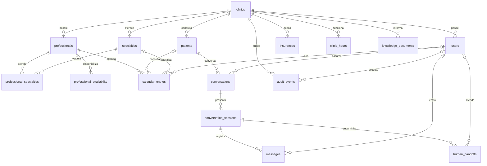

# Modelo entidade-relacionamento — proposta v1

Todos os registros subordinados incluem `clinic_id`. Relacionamentos usam chaves estrangeiras compostas para impedir vínculos entre clínicas. A figura omite essas linhas repetitivas; as restrições completas estão no SQL.

`calendar_entries` reúne consultas e bloqueios. `appointments` e `calendar_blocks` são views filtradas. Isso permite uma única restrição de exclusão para impedir disputa entre consulta e bloqueio. Bloqueios não têm paciente/especialidade; consultas exigem ambos.

Horários absolutos usam `timestamptz`; a apresentação usa o fuso da clínica. Faixas semanais usam dia 0=domingo até 6=sábado e horário local. Intervalos são `[início,fim)`: uma consulta pode começar exatamente quando a anterior termina.
